# 🔄 Diagrama de Flujo del Chatbot de WhatsApp (Versión 2 Mejorada)
> **Última sincronización automática:** 2026-10-13 00:52:08  
> **Archivo origen:** `chatbot/index.ts` (analizado automáticamente)

Este diagrama representa con exactitud la lógica activa en el código del chatbot. Se actualiza de forma automática cada vez que se realizan modificaciones en `chatbot/index.ts`.

---

## 🗺️ Flujograma Activo

```mermaid
flowchart TD
    %% Flujo mejorado del chatbot de pedidos por WhatsApp (v2)
    %% Incluye: Volver atrás global, selector de cantidades, asesor en cada paso,
    %% fotos de platos, quitar plato del carrito y confirmación de cancelación.

    Inicio(["👤 Cliente envía mensaje por WhatsApp"])
    ComandosCheck{"¿Es comando especial?<br/>hola / menu / volver / cancelar / asesor<br/>(o toca el botón ⬅️ Volver / 👨‍💼 Asesor)"}

    %% Reglas Globales
    ReglaGlobal["📌 Reglas en TODOS los pasos:<br/>• Listas interactivas: filas fijas ⬅️ Volver y 👨‍💼 Asesor al final (tope 10 filas)<br/>• Botones rápidos: ⬅️ Volver si hay lugar, Asesor en pie de mensaje<br/>• Historial en wa_sesiones para retroceder con carrito intacto"]

    %% Atención Humana (Asesor)
    ModoHumano["👨‍💼 Pausa el bot y activa Modo Humano<br/>Sesión: modo = 'humano'<br/>Conserva el paso actual y el carrito"]
    NotificarPersonal["🔔 Avisa al personal en el restaurante<br/>Nombre, teléfono y carrito acumulado"]
    AtencionHumana["💬 Atención por persona capacitada<br/>El bot guarda silencio"]
    ReanudarBot["▶️ Reactiva el bot: modo = 'bot'<br/>Vuelve al menú con carrito intacto"]
    OfrecerAsesor{"🤝 ¿Te atiende una persona?<br/>Botones: 👨‍💼 Sí, con asesor · 🤖 Seguir con bot"}

    %% Volver y Cancelar
    Volver["⬅️ Volver un paso<br/>Recupera estado del historial<br/>El carrito se conserva"]
    Repintar["Re-envía la pantalla del paso anterior<br/>menú · categorías · platos · cantidad · carrito · pago"]
    ConfirmarCancelar{"⚠️ ¿Cancelar todo el pedido?<br/>Botones: 🗑️ Sí, cancelar · ↩️ No, seguir"}
    ResetSesion["🔄 Reinicia el carrito a cero<br/>Sesión: estado = 'menu', carrito = []"]

    %% Nombre Obligatorio
    CheckNombre{"¿El cliente ya tiene<br/>nombre guardado?"}
    PedirNombre["📝 Bot solicita Nombre y Apellido<br/>Estado: 'pedir_nombre'"]
    ClienteEnviaNombre["Cliente escribe su nombre<br/>Ej: 'Alex Gomez'"]
    GuardarNombre["💾 Guarda nombre en wa_sesiones<br/>Envía: '¡Mucho gusto, Alex! 🙌'"]

    %% Menú Principal
    MenuPrincipal["🍽️ Menú Principal Interactivo<br/>Estado: 'menu'<br/>Botones: ⭐ Más pedidos · 📖 Toda la carta · 👨‍💼 Asesor"]
    OpcionesMenu{"¿Qué botón presiona?"}
    Destacados["⭐ Lista: Platos Más Pedidos<br/>• Arroz con Mariscos Trio (S/ 35.00)<br/>• Chaufa Trio Ceviche (S/ 35.00)<br/>• Arroz Marisco Duo (S/ 25.00)<br/>• Chicharron Pescado Duo (S/ 25.00)<br/>• Ceviche Clasico (S/ 20.00)<br/>• Leche Tigre al Macho (S/ 18.00)<br/>• Chicha Morada Jarra (S/ 15.00)<br/>Filas fijas: ⬅️ Volver · 👨‍💼 Asesor"]
    Categorias["📂 Lista de Categorías<br/>1. Duos<br/>2. Personal<br/>3. Trio<br/>4. Piqueos<br/>5. Bebidas<br/>Filas fijas: ⬅️ Volver · 👨‍💼 Asesor"]
    SelCategoria["Cliente elige una categoría"]
    PlatosCategoria["Consulta la tabla 'producto'<br/>Muestra platos (máx. 7 por página) + ➡️ Ver más + ⬅️ Volver + 👨‍💼 Asesor"]
    ElegirPlato["Cliente selecciona un plato"]

    %% Cantidad y Porciones
    PedirCantidad["🔢 Pregunta Cantidad (con foto si existe)<br/>Estado: 'seleccion_cantidad'<br/>Botones: 1 porción · 2 porciones · ➕ Más cantidades"]
    ElegirCantidad{"¿Qué elige?"}
    CantidadMas["🔢 Lista de más porciones<br/>3 · 4 · 5 · 6 · 7 · 8 porciones<br/>✍️ Otra cantidad<br/>Filas fijas: ⬅️ Volver · 👨‍💼 Asesor"]
    CantidadEscrita["✍️ Pide escribir la cantidad numéricamente"]
    ValidarCantidad{"¿Es un número válido?"}

    %% Carrito
    AgregarCarrito["🛒 Agrega al Carrito en wa_sesiones<br/>Calcula subtotal: cantidad x precio<br/>Estado: 'en_carrito'"]
    OpcionesCarrito{"Resumen del pedido y total en soles"}
    QuitarPlato["✏️ Lista de platos del carrito<br/>Elimina el plato elegido y recalcula el total<br/>Filas fijas: ⬅️ Volver · 🗑️ Cancelar todo"]

    %% Pago y Ubicación
    MetodoPago["💰 Selección de Método de Pago<br/>Estado: 'seleccion_pago'<br/>Botones: 📲 Yape · 📲 Plin · 💵 Efectivo"]
    ElegirPago{"Botón de Pago"}
    PagoDigital["Registra método Yape/Plin<br/>Indica que se valida contra entrega"]
    PagoEfectivo["Pregunta: ¿Con cuánto vas a pagar?<br/>Estado: 'esperando_vuelto'"]
    ClienteIndicaMonto["Cliente escribe monto. Ej: '50' o '100'<br/>Guarda paga_con y calcula vuelto"]
    SolicitarUbicacion["📍 Solicita Ubicación de Entrega<br/>Estado: 'esperando_ubicacion'"]
    TipoUbicacion{"¿Cómo envía ubicación?"}
    CapturaGPS["Extrae latitud y longitud<br/>Genera enlace de Google Maps"]
    CapturaTexto["Guarda dirección y referencia escrita"]

    %% Inserción en Base de Datos
    InsertarBD["💾 Inserción Transaccional en Base de Datos<br/>RPC: insertar_pedido_y_detalles<br/>• mesa = 0 (DELIVERY)<br/>• idmozo = 1 (Delivery)<br/>• estado = '1' (PENDIENTE / NO COBRADO)<br/>• lugarpedido = '1' (Para Llevar)<br/>• telefono = 519XXXXXXXX<br/>• direccion, gps, metodo_pago, paga_con"]
    ConfirmarCliente["🎉 Mensaje de Confirmación al Cliente:<br/>• N° de Pedido #ID<br/>• Detalle de platos y Total S/<br/>• Enlace de Google Maps<br/>• Estado: Enviado a cocina"]
    ResetFinal["Limpia sesión para siguiente pedido:<br/>estado = 'inicio', carrito = []"]
    POSAngular["🖥️ Sistema POS Angular del Restaurante"]

    subgraph POS_ANGULAR ["🖥️ Respuesta Inmediata en el Sistema POS"]
        POSAngular --> ChimeSonoro["🔔 Campana Sonora en bucle cada 3.2s"]
        POSAngular --> AutoRefresh["⚡ ListarPedidos() auto-refresca pedidos activos"]
        POSAngular --> ModalRojo["🚨 Modal Rojo Urgente en Pantalla Completa<br/>Datos del cliente, platos, teléfono, mapa y vuelto"]
        ModalRojo --> ClickAtender["Botón: '🚨 Atender Pedido e Imprimir Comanda'"]
        ClickAtender --> Silenciar["Silencia campana y cierra modal"]
        ClickAtender --> SeleccionarMesa0["Autoselecciona Mesa 0 en panel de pedidos"]
        ClickAtender --> ImprimirComanda["📄 Dispara y abre PDF de Comanda de Cocina listo para imprimir"]
    end

    %% Conexiones
    Inicio --> ComandosCheck
    ReglaGlobal -.-> ComandosCheck
    ComandosCheck -->|"asesor / humano / 👨‍💼"| ModoHumano
    ComandosCheck -->|"volver / ⬅️"| Volver
    ComandosCheck -->|"cancelar"| ConfirmarCancelar
    ComandosCheck -.->|"2 errores seguidos"| OfrecerAsesor
    ComandosCheck -->|"Mensaje normal / hola / menu"| CheckNombre

    ModoHumano --> NotificarPersonal --> AtencionHumana
    AtencionHumana -->|"Escribe menu o bot"| ReanudarBot
    ReanudarBot --> MenuPrincipal
    OfrecerAsesor -->|"Sí, con asesor"| ModoHumano
    OfrecerAsesor -->|"Seguir con bot"| Repintar

    Volver --> Repintar
    ConfirmarCancelar -->|"Sí, cancelar"| ResetSesion
    ConfirmarCancelar -->|"No, seguir"| Repintar
    ResetSesion --> MenuPrincipal

    CheckNombre -->|"No o estado='pedir_nombre'"| PedirNombre
    CheckNombre -->|"Sí"| MenuPrincipal
    PedirNombre --> ClienteEnviaNombre --> GuardarNombre --> MenuPrincipal

    MenuPrincipal --> OpcionesMenu
    OpcionesMenu -->|"⭐ Más pedidos"| Destacados
    OpcionesMenu -->|"📖 Toda la carta"| Categorias
    OpcionesMenu -->|"👨‍💼 Asesor"| ModoHumano
    Categorias --> SelCategoria --> PlatosCategoria
    Destacados --> ElegirPlato
    PlatosCategoria --> ElegirPlato

    ElegirPlato --> PedirCantidad --> ElegirCantidad
    ElegirCantidad -->|"1 o 2 porciones"| AgregarCarrito
    ElegirCantidad -->|"➕ Más cantidades"| CantidadMas
    ElegirCantidad -->|"Escribe un número"| ValidarCantidad
    CantidadMas -->|"3 a 8 porciones"| AgregarCarrito
    CantidadMas -->|"✍️ Otra cantidad"| CantidadEscrita
    CantidadEscrita --> ValidarCantidad
    ValidarCantidad -->|"Sí (1 a 20)"| AgregarCarrito
    ValidarCantidad -->|"Más de 20 (pedido grande)"| ModoHumano
    ValidarCantidad -->|"No es válido"| CantidadEscrita

    AgregarCarrito --> OpcionesCarrito
    OpcionesCarrito -->|"🛍️ Finalizar pedido"| MetodoPago
    OpcionesCarrito -->|"➕ Seguir pidiendo"| MenuPrincipal
    OpcionesCarrito -->|"✏️ Quitar un plato"| QuitarPlato
    OpcionesCarrito -->|"🗑️ Cancelar todo"| ConfirmarCancelar
    QuitarPlato --> OpcionesCarrito
    QuitarPlato -->|"Carrito vacío"| MenuPrincipal

    MetodoPago --> ElegirPago
    ElegirPago -->|"📲 Yape / Plin"| PagoDigital
    ElegirPago -->|"💵 Efectivo"| PagoEfectivo
    PagoEfectivo --> ClienteIndicaMonto
    PagoDigital --> SolicitarUbicacion
    ClienteIndicaMonto --> SolicitarUbicacion
    SolicitarUbicacion --> TipoUbicacion
    TipoUbicacion -->|"Ubicación GPS (clip WhatsApp)"| CapturaGPS
    TipoUbicacion -->|"Texto escrito"| CapturaTexto

    CapturaGPS --> InsertarBD
    CapturaTexto --> InsertarBD
    InsertarBD --> ConfirmarCliente
    InsertarBD --> ResetFinal
    InsertarBD -. Realtime postgres_changes .-> POSAngular
```



---

## 📊 Metadatos Detectados del Código Fuente

| Parámetro | Valores Detectados en el Código |
| :--- | :--- |
| **Estados de Sesión** | `menu, en_carrito, seleccion_pago, esperando_ubicacion, pedir_nombre, confirmar_cancelar, inicio, seleccion_cantidad, seleccion_cantidad_mas, seleccion_cantidad_otra, quitar_plato, esperando_vuelto, 1` |
| **Platos Destacados** | 7 platos registrados (`Arroz con Mariscos Trio, Chaufa Trio Ceviche, Arroz Marisco Duo, Chicharron Pescado Duo...`) |
| **Categorías de Carta** | 5 categorías (`Duos, Personal, Trio, Piqueos, Bebidas`) |
| **Métodos de Pago** | `Yape, Plin, Efectivo` |
| **Regla de Mesa Delivery** | `mesa = 0` |
| **Regla de Estado Pago** | `estado = '1'` (Pendiente / No Cobrado) |
| **Mozo Asignado** | `idmozo = 1` (Delivery) |

---

## 🛠️ Cómo regenerar este diagrama automáticamente
Si realizaste cambios en `chatbot/index.ts`, el diagrama se actualiza solo al hacer `git commit`.  
También puedes forzar la actualización ejecutando:
```bash
npm run update-diagram
```
O mantenerlo sincronizado en tiempo real mientras programas con:
```bash
npm run watch-diagram
```
