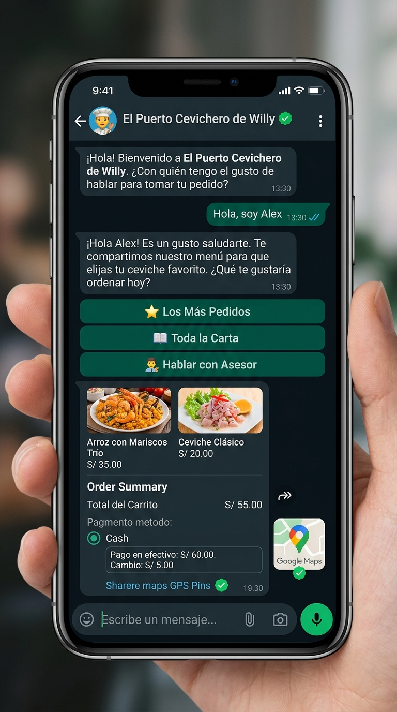
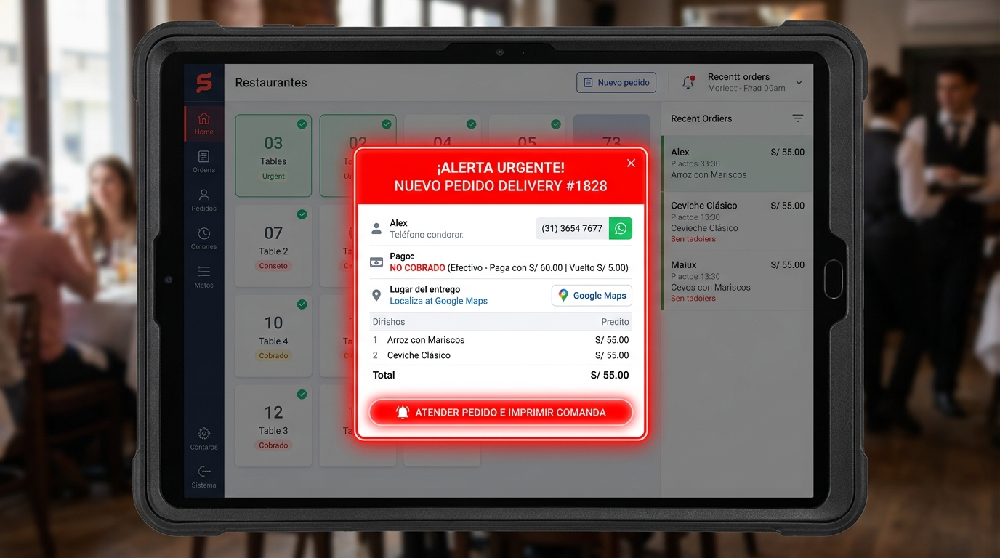
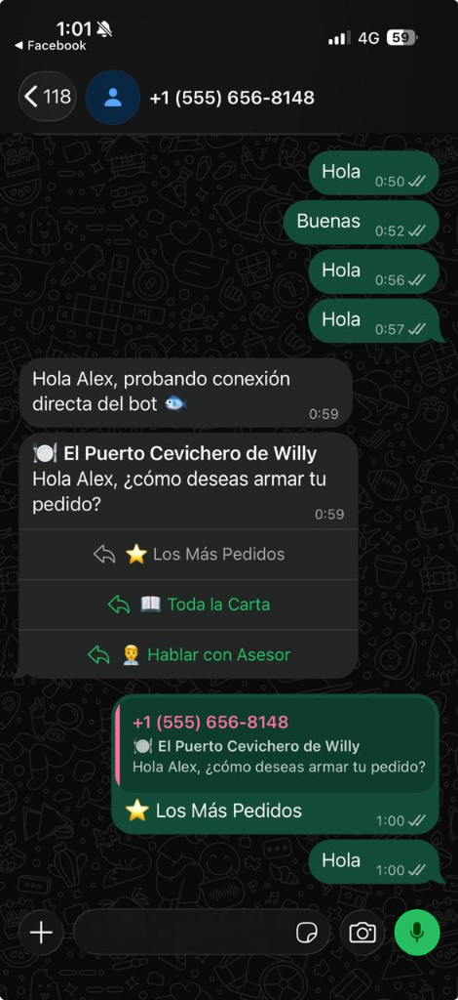

# 📋 Manual Completo y Diagrama de Flujo del Chatbot de WhatsApp
## "El Puerto Cevichero de Willy" — Sistema de Pedidos Delivery y Alerta POS

Este documento detalla **cada una de las opciones, estados, botones, comandos y comportamientos** del Chatbot de WhatsApp oficial y su integración en tiempo real con el POS Angular del restaurante.

---

## 📸 1. Vistas Principales del Sistema

| Interacción en WhatsApp con el Cliente | Alerta Roja Urgente e Impresión en POS | Captura Real de Conversación |
| :---: | :---: | :---: |
|  |  |  |

---

## 🗺️ 2. Diagrama de Flujo General (Flujograma de Decisiones)

```mermaid
flowchart TD
    %% Flujo mejorado del chatbot de pedidos por WhatsApp (v2)
    %% Incluye: Volver atrás global, selector de cantidades, asesor en cada paso,
    %% fotos de platos, quitar plato del carrito y confirmación de cancelación.

    Inicio(["👤 Cliente envía mensaje por WhatsApp"])
    ComandosCheck{"¿Es comando especial?<br/>hola / menu / volver / cancelar / asesor<br/>(o toca el botón ⬅️ Volver / 👨‍💼 Asesor)"}

    %% Reglas Globales
    ReglaGlobal["📌 Reglas en TODOS los pasos:<br/>• Listas interactivas: filas fijas ⬅️ Volver y 👨‍💼 Asesor al final (tope 10 filas)<br/>• Botones rápidos: ⬅️ Volver si hay lugar, Asesor en pie de mensaje<br/>• Historial en wa_sesiones para retroceder con carrito intacto"]

    %% Atención Humana (Asesor)
    ModoHumano["👨‍💼 Pausa el bot y activa Modo Humano<br/>Sesión: modo = 'humano'<br/>Conserva el paso actual y el carrito"]
    NotificarPersonal["🔔 Avisa al personal en el restaurante<br/>Nombre, teléfono y carrito acumulado"]
    AtencionHumana["💬 Atención por persona capacitada<br/>El bot guarda silencio"]
    ReanudarBot["▶️ Reactiva el bot: modo = 'bot'<br/>Vuelve al menú con carrito intacto"]
    OfrecerAsesor{"🤝 ¿Te atiende una persona?<br/>Botones: 👨‍💼 Sí, con asesor · 🤖 Seguir con bot"}

    %% Volver y Cancelar
    Volver["⬅️ Volver un paso<br/>Recupera estado del historial<br/>El carrito se conserva"]
    Repintar["Re-envía la pantalla del paso anterior<br/>menú · categorías · platos · cantidad · carrito · pago"]
    ConfirmarCancelar{"⚠️ ¿Cancelar todo el pedido?<br/>Botones: 🗑️ Sí, cancelar · ↩️ No, seguir"}
    ResetSesion["🔄 Reinicia el carrito a cero<br/>Sesión: estado = 'menu', carrito = []"]

    %% Nombre Obligatorio
    CheckNombre{"¿El cliente ya tiene<br/>nombre guardado?"}
    PedirNombre["📝 Bot solicita Nombre y Apellido<br/>Estado: 'pedir_nombre'"]
    ClienteEnviaNombre["Cliente escribe su nombre<br/>Ej: 'Alex Gomez'"]
    GuardarNombre["💾 Guarda nombre en wa_sesiones<br/>Envía: '¡Mucho gusto, Alex! 🙌'"]

    %% Menú Principal
    MenuPrincipal["🍽️ Menú Principal Interactivo<br/>Estado: 'menu'<br/>Botones: ⭐ Más pedidos · 📖 Toda la carta · 👨‍💼 Asesor"]
    OpcionesMenu{"¿Qué botón presiona?"}
    Destacados["⭐ Lista: Platos Más Pedidos<br/>• Arroz con Mariscos Trio (S/ 35.00)<br/>• Chaufa Trio Ceviche (S/ 35.00)<br/>• Arroz Marisco Duo (S/ 25.00)<br/>• Chicharron Pescado Duo (S/ 25.00)<br/>• Ceviche Clasico (S/ 20.00)<br/>• Leche Tigre al Macho (S/ 18.00)<br/>• Chicha Morada Jarra (S/ 15.00)<br/>Filas fijas: ⬅️ Volver · 👨‍💼 Asesor"]
    Categorias["📂 Lista de Categorías<br/>1. Duos<br/>2. Personal<br/>3. Trio<br/>4. Piqueos<br/>5. Bebidas<br/>Filas fijas: ⬅️ Volver · 👨‍💼 Asesor"]
    SelCategoria["Cliente elige una categoría"]
    PlatosCategoria["Consulta la tabla 'producto'<br/>Muestra platos (máx. 7 por página) + ➡️ Ver más + ⬅️ Volver + 👨‍💼 Asesor"]
    ElegirPlato["Cliente selecciona un plato"]

    %% Cantidad y Porciones
    PedirCantidad["🔢 Pregunta Cantidad (con foto si existe)<br/>Estado: 'seleccion_cantidad'<br/>Botones: 1 porción · 2 porciones · ➕ Más cantidades"]
    ElegirCantidad{"¿Qué elige?"}
    CantidadMas["🔢 Lista de más porciones<br/>3 · 4 · 5 · 6 · 7 · 8 porciones<br/>✍️ Otra cantidad<br/>Filas fijas: ⬅️ Volver · 👨‍💼 Asesor"]
    CantidadEscrita["✍️ Pide escribir la cantidad numéricamente"]
    ValidarCantidad{"¿Es un número válido?"}

    %% Carrito
    AgregarCarrito["🛒 Agrega al Carrito en wa_sesiones<br/>Calcula subtotal: cantidad x precio<br/>Estado: 'en_carrito'"]
    OpcionesCarrito{"Resumen del pedido y total en soles"}
    QuitarPlato["✏️ Lista de platos del carrito<br/>Elimina el plato elegido y recalcula el total<br/>Filas fijas: ⬅️ Volver · 🗑️ Cancelar todo"]

    %% Pago y Ubicación
    MetodoPago["💰 Selección de Método de Pago<br/>Estado: 'seleccion_pago'<br/>Botones: 📲 Yape · 📲 Plin · 💵 Efectivo"]
    ElegirPago{"Botón de Pago"}
    PagoDigital["Registra método Yape/Plin<br/>Indica que se valida contra entrega"]
    PagoEfectivo["Pregunta: ¿Con cuánto vas a pagar?<br/>Estado: 'esperando_vuelto'"]
    ClienteIndicaMonto["Cliente escribe monto. Ej: '50' o '100'<br/>Guarda paga_con y calcula vuelto"]
    SolicitarUbicacion["📍 Solicita Ubicación de Entrega<br/>Estado: 'esperando_ubicacion'"]
    TipoUbicacion{"¿Cómo envía ubicación?"}
    CapturaGPS["Extrae latitud y longitud<br/>Genera enlace de Google Maps"]
    CapturaTexto["Guarda dirección y referencia escrita"]

    %% Inserción en Base de Datos
    InsertarBD["💾 Inserción Transaccional en Base de Datos<br/>RPC: insertar_pedido_y_detalles<br/>• mesa = 0 (DELIVERY)<br/>• idmozo = 1 (Delivery)<br/>• estado = '1' (PENDIENTE / NO COBRADO)<br/>• lugarpedido = '1' (Para Llevar)<br/>• telefono = 519XXXXXXXX<br/>• direccion, gps, metodo_pago, paga_con"]
    ConfirmarCliente["🎉 Mensaje de Confirmación al Cliente:<br/>• N° de Pedido #ID<br/>• Detalle de platos y Total S/<br/>• Enlace de Google Maps<br/>• Estado: Enviado a cocina"]
    ResetFinal["Limpia sesión para siguiente pedido:<br/>estado = 'inicio', carrito = []"]
    POSAngular["🖥️ Sistema POS Angular del Restaurante"]

    subgraph POS_ANGULAR ["🖥️ Respuesta Inmediata en el Sistema POS"]
        POSAngular --> ChimeSonoro["🔔 Campana Sonora en bucle cada 3.2s"]
        POSAngular --> AutoRefresh["⚡ ListarPedidos() auto-refresca pedidos activos"]
        POSAngular --> ModalRojo["🚨 Modal Rojo Urgente en Pantalla Completa<br/>Datos del cliente, platos, teléfono, mapa y vuelto"]
        ModalRojo --> ClickAtender["Botón: '🚨 Atender Pedido e Imprimir Comanda'"]
        ClickAtender --> Silenciar["Silencia campana y cierra modal"]
        ClickAtender --> SeleccionarMesa0["Autoselecciona Mesa 0 en panel de pedidos"]
        ClickAtender --> ImprimirComanda["📄 Dispara y abre PDF de Comanda de Cocina listo para imprimir"]
    end

    %% Conexiones
    Inicio --> ComandosCheck
    ReglaGlobal -.-> ComandosCheck
    ComandosCheck -->|"asesor / humano / 👨‍💼"| ModoHumano
    ComandosCheck -->|"volver / ⬅️"| Volver
    ComandosCheck -->|"cancelar"| ConfirmarCancelar
    ComandosCheck -.->|"2 errores seguidos"| OfrecerAsesor
    ComandosCheck -->|"Mensaje normal / hola / menu"| CheckNombre

    ModoHumano --> NotificarPersonal --> AtencionHumana
    AtencionHumana -->|"Escribe menu o bot"| ReanudarBot
    ReanudarBot --> MenuPrincipal
    OfrecerAsesor -->|"Sí, con asesor"| ModoHumano
    OfrecerAsesor -->|"Seguir con bot"| Repintar

    Volver --> Repintar
    ConfirmarCancelar -->|"Sí, cancelar"| ResetSesion
    ConfirmarCancelar -->|"No, seguir"| Repintar
    ResetSesion --> MenuPrincipal

    CheckNombre -->|"No o estado='pedir_nombre'"| PedirNombre
    CheckNombre -->|"Sí"| MenuPrincipal
    PedirNombre --> ClienteEnviaNombre --> GuardarNombre --> MenuPrincipal

    MenuPrincipal --> OpcionesMenu
    OpcionesMenu -->|"⭐ Más pedidos"| Destacados
    OpcionesMenu -->|"📖 Toda la carta"| Categorias
    OpcionesMenu -->|"👨‍💼 Asesor"| ModoHumano
    Categorias --> SelCategoria --> PlatosCategoria
    Destacados --> ElegirPlato
    PlatosCategoria --> ElegirPlato

    ElegirPlato --> PedirCantidad --> ElegirCantidad
    ElegirCantidad -->|"1 o 2 porciones"| AgregarCarrito
    ElegirCantidad -->|"➕ Más cantidades"| CantidadMas
    ElegirCantidad -->|"Escribe un número"| ValidarCantidad
    CantidadMas -->|"3 a 8 porciones"| AgregarCarrito
    CantidadMas -->|"✍️ Otra cantidad"| CantidadEscrita
    CantidadEscrita --> ValidarCantidad
    ValidarCantidad -->|"Sí (1 a 20)"| AgregarCarrito
    ValidarCantidad -->|"Más de 20 (pedido grande)"| ModoHumano
    ValidarCantidad -->|"No es válido"| CantidadEscrita

    AgregarCarrito --> OpcionesCarrito
    OpcionesCarrito -->|"🛍️ Finalizar pedido"| MetodoPago
    OpcionesCarrito -->|"➕ Seguir pidiendo"| MenuPrincipal
    OpcionesCarrito -->|"✏️ Quitar un plato"| QuitarPlato
    OpcionesCarrito -->|"🗑️ Cancelar todo"| ConfirmarCancelar
    QuitarPlato --> OpcionesCarrito
    QuitarPlato -->|"Carrito vacío"| MenuPrincipal

    MetodoPago --> ElegirPago
    ElegirPago -->|"📲 Yape / Plin"| PagoDigital
    ElegirPago -->|"💵 Efectivo"| PagoEfectivo
    PagoEfectivo --> ClienteIndicaMonto
    PagoDigital --> SolicitarUbicacion
    ClienteIndicaMonto --> SolicitarUbicacion
    SolicitarUbicacion --> TipoUbicacion
    TipoUbicacion -->|"Ubicación GPS (clip WhatsApp)"| CapturaGPS
    TipoUbicacion -->|"Texto escrito"| CapturaTexto

    CapturaGPS --> InsertarBD
    CapturaTexto --> InsertarBD
    InsertarBD --> ConfirmarCliente
    InsertarBD --> ResetFinal
    InsertarBD -. Realtime postgres_changes .-> POSAngular
```



---

## 🌳 3. Árbol de Estados y Comportamiento en Cada Opción

La conversación es gobernada por una **máquina de estados** almacenada en la tabla `wa_sesiones` de Supabase:

### Estado 1: `pedir_nombre` (Captura Obligatoria del Cliente)
* **Condición de entrada**: Cliente nuevo (no tiene nombre guardado) o escribe por primera vez.
* **Mensaje del Bot**:
  > *"¡Hola! 🐟 Bienvenido a **El Puerto Cevichero de Willy**.*  
  > *Para poder registrar tu pedido y atenderte mejor, **¿cuál es tu nombre y apellido?**"*
* **Opciones del usuario**:
  - Escribe su nombre en texto libre (ej: `"Alex"`, `"María Torres"`).
* **Acción del sistema**:
  - Actualiza `wa_sesiones.nombre = 'Alex'`.
  - Cambia `estado = 'menu'`.
  - Responde: *"¡Mucho gusto, Alex! 🙌"* y despliega inmediatamente el Menú Principal.

---

### Estado 2: `menu` (Menú Principal Interactivo)
* **Mensaje del Bot**:
  > *"🍽️ **El Puerto Cevichero de Willy**  
  > Hola Alex, ¿cómo deseas armar tu pedido?"*
* **Botones desplegados**:

| Botón (Título) | ID Interno | Comportamiento del Sistema |
| :--- | :--- | :--- |
| **⭐ Los Más Pedidos** | `ver_destacados` | Abre una lista interactiva de WhatsApp con los 9 platos más solicitados (Tríos, Dúos, Ceviches, Bebidas). |
| **📖 Toda la Carta** | `ver_categorias` | Abre una lista interactiva con las 5 categorías oficiales: Dúos, Personal, Tríos, Piqueos, Bebidas. |
| **👨‍💼 Hablar con Asesor** | `pedir_asesor` | Pausa el bot (`modo = 'humano'`) y notifica al cliente que un asesor responderá directamente. |

---

### Estado 3: Navegación de Platos (`ver_destacados` y `ver_categorias`)

#### A. Al elegir "⭐ Los Más Pedidos" (`ver_destacados`)
Muestra la lista interactiva nativa con los siguientes platos y precios en soles:
1. `prod_8`: **Arroz con Mariscos Trío** — S/ 35.00
2. `prod_104`: **Chaufa Trío Ceviche Chicharrón** — S/ 35.00
3. `prod_3`: **Arroz con Mariscos Dúo** — S/ 25.00
4. `prod_2`: **Chicharrón de Pescado Dúo** — S/ 25.00
5. `prod_13`: **Ceviche Clásico Personal** — S/ 20.00
6. `prod_61`: **Leche de Tigre a lo Macho** — S/ 18.00
7. `prod_65`: **Chilcano de Pescado** — S/ 12.00
8. `prod_74`: **Chicha Morada Jarra** — S/ 15.00
9. `prod_78`: **Gaseosa 1/2 Litro** — S/ 6.00

#### B. Al elegir "📖 Toda la Carta" (`ver_categorias`)
1. `cat_1`: **Dúos**
2. `cat_2`: **Personal**
3. `cat_3`: **Trío**
4. `cat_4`: **Piqueos**
5. `cat_5`: **Bebidas**

Al presionar cualquier categoría, consulta dinámicamente en Supabase la tabla `producto` (`WHERE idcategoria = X AND deleted IS NULL`) y genera la lista de platos en vivo.

---

### Estado 4: `seleccion_cantidad` (Selección de Porciones)
* **Condición de entrada**: El cliente tocó un plato (ej: `prod_8`).
* **Mensaje del Bot**:
  > *"🐟 **Arroz con Mariscos Trío**  
  > Precio: S/ 35.00  
  >   
  > ¿Cuántas porciones deseas?"*
* **Botones desplegados**:
  - `cant_1`: **1 porción**
  - `cant_2`: **2 porciones**
  - `cant_3`: **3 porciones**
  - *(También permite escribir cualquier número por texto, ej: `5`)*
* **Acción del sistema**:
  - Multiplica `cantidad × preciounitario`.
  - Agrega el ítem al array `carrito` en `wa_sesiones`.
  - Cambia `estado = 'en_carrito'`.

---

### Estado 5: `en_carrito` (Gestión del Carrito)
* **Mensaje del Bot**:
  > *"✅ Agregado: **1x Arroz con Mariscos Trío** (S/ 35.00)  
  >   
  > ¿Deseas pedir algo más o finalizar tu pedido?"*
* **Botones disponibles**:

| Botón | ID | Comportamiento |
| :--- | :--- | :--- |
| **➕ Seguir pidiendo** | `seguir_pidiendo` | Regresa al Menú Principal (`estado = 'menu'`) sin perder los platos acumulados. |
| **🛍️ Finalizar pedido** | `confirmar_pedido` | Muestra el resumen total acumulado y pasa a la fase de pago (`estado = 'seleccion_pago'`). |
| **🗑️ Cancelar todo** | `reiniciar` | Vacía el carrito por completo (`carrito = []`) y regresa al menú. |

---

### Estado 6: `seleccion_pago` (Método de Pago Contra-Entrega)
* **Regla estricta**: Los pedidos por WhatsApp entran en estado **PENDIENTE / NO COBRADO (`estado = '1'`)**. El bot no procesa cobros automáticos; registra la modalidad elegida para que el repartidor o cajero cobre en la entrega.
* **Mensaje del Bot**:
  > *"💰 El total a pagar es **S/ 55.00**.  
  >   
  > ¿Cómo deseas pagar cuando llegue tu pedido?"*
* **Botones desplegados**:

| Botón | ID | Comportamiento |
| :--- | :--- | :--- |
| **📲 Yape** | `pago_yape` | Registra método `Yape`. Informa que pagará contra entrega y salta a pedir ubicación. |
| **📲 Plin** | `pago_plin` | Registra método `Plin`. Informa que pagará contra entrega y salta a pedir ubicación. |
| **💵 Efectivo** | `pago_efectivo` | Registra método `Efectivo`. Cambia a estado `esperando_vuelto`. |

---

### Estado 7: `esperando_vuelto` (Cálculo de Vuelto para Efectivo)
* **Condición de entrada**: El cliente seleccionó `💵 Efectivo`.
* **Mensaje del Bot**:
  > *"💵 Tu total es **S/ 55.00**.  
  >   
  > **¿Con cuánto vas a pagar en efectivo?**  
  > (Ejemplo: escribe **100** para que el repartidor lleve tu vuelto listo):"*
* **Respuesta del usuario**: Escribe el billete (ej: `"100"` o `"70"`).
* **Acción del sistema**:
  - Guarda `paga_con = 100.00`.
  - Calcula el vuelto: `100.00 - 55.00 = S/ 45.00`.
  - Este vuelto se incluye en la nota del pedido y en la alerta roja del POS.
  - Cambia a `estado = 'esperando_ubicacion'`.

---

### Estado 8: `esperando_ubicacion` (Dirección de Entrega y GPS)
* **Mensaje del Bot**:
  > *"📍 **Último paso:** Comparte tu **Ubicación en tiempo real / GPS** mediante el botón 📎 de WhatsApp, o escribe tu **Dirección exacta y referencia** (Ej: Jr. Los Pinos 123, frente al parque):"*
* **Opciones del usuario**:
  1. **Ubicación GPS interactiva (Recomendada)**: Toca el icono de adjuntar 📎 en WhatsApp y selecciona "Ubicación".
     - El bot extrae `latitude` y `longitude` numéricos.
     - Genera automáticamente el link de navegación: `https://maps.google.com/?q=LAT,LNG`.
  2. **Texto con Dirección y Referencia**: Escribe su dirección (ej: `"Av. Grau 450, 2do piso, timbre blanco"`).

---

### Estado 9: `registro_pedido` (Inserción Transaccional y Confirmación)
Al recibir la ubicación, el backend ejecuta la transacción atómica:
1. **Llama a la función RPC de Supabase**: `insertar_pedido_y_detalles`.
   - `cliente`: Nombre registrado (`Alex`).
   - `mesa`: `0` (*Identificador de pedidos Delivery*).
   - `idmozo`: `1` (*Mozo configurado para Delivery*).
   - `estado`: `'1'` (*Pendiente / No cobrado*).
   - `lugarpedido`: `'1'` (*Para llevar*).
   - `total_pedidos`: Suma de porciones.
   - `total`: Monto total en soles.
2. **Actualiza datos adicionales en `pedido`**:
   - `telefono`: Número de WhatsApp.
   - `direccion`, `latitud`, `longitud`.
   - `metodo_pago`: (`Yape`, `Plin`, `Efectivo`).
   - `paga_con`: Monto con el que paga.
   - `comentario`: `[PEDIDO WHATSAPP DELIVERY] Método de pago: Efectivo (Paga con: S/ 100.00 | Vuelto: S/ 45.00) | Dirección: ...`
3. **Reinicia la sesión del cliente**: `estado = 'inicio'`, `carrito = []` (manteniendo su nombre para futuros pedidos).
4. **Envía Confirmación al Cliente por WhatsApp**:
   > *"🎉 **¡PEDIDO CONFIRMADO CON ÉXITO!** 🎉  
   > 📋 **Pedido N°:** #1828  
   > 👤 **Cliente:** Alex  
   > 💰 **Total:** S/ 55.00  
   > 💳 **Pago:** Efectivo (se cobra contra entrega)  
   > 📍 **Entrega:** Av. Grau 450 (🗺️ Mapa: https://maps.google.com/?q=...)  
   >   
   > 👨‍🍳 El equipo de cocina de **El Puerto Cevichero de Willy** ya recibió tu comanda y comenzará su preparación. ¡Muchas gracias!"*

---

## 🚨 4. Comportamiento en el Sistema POS Angular (`RestauranteCevicheriav2`)

En cuanto el pedido se guarda en Supabase, ocurre la siguiente cadena de eventos **sin recargar la página**:

```
[ Supabase Realtime: INSERT en pedido ]
               │
               ▼
[ AlertaWhatsappComponent ]
 ├── 1. Inicia Chime Sonoro de Restaurante (Web Audio API en bucle cada 3.2s).
 ├── 2. Emite evento reactivo nuevoPedidoWhatsApp$ a HomeComponent.
 └── 3. Abre Modal Rojo Urgente con animación de pulso y borde neón 3px.
               │
               ▼
[ HomeComponent ]
 └── Ejecuta ListarPedidos():
     • Actualiza el contador de "Pedidos Activos en Cocina".
     • Agrega la tarjeta del nuevo pedido con su insignia "DELIVERY".
               │
               ▼
[ Cajero hace clic en: "🚨 Atender Pedido e Imprimir Comanda" ]
 ├── 1. Silencia el sonido y cierra el modal de alerta.
 ├── 2. Abre automáticamente la lista de Delivery (mesa = '0').
 ├── 3. Selecciona la mesa y carga los platos en la cuenta lateral.
 └── 4. Dispara automáticamente generateCocinaPDFCard(pedido)
        └── Abre el PDF de la Comanda de Cocina listo para mandar a imprimir.
```

---

## 🛠️ 5. Comandos Especiales (Universales)

En cualquier momento de la conversación, el cliente o el administrador puede enviar los siguientes comandos de texto:

| Comando | Acción del Bot |
| :--- | :--- |
| `hola` / `menu` / `inicio` | Resetea el carrito a cero y muestra el Menú Principal con el nombre del cliente reconocido. |
| `cancelar` / `reiniciar` | Limpia los platos del carrito y vuelve a la pantalla inicial. |
| `asesor` / `humano` | Pausa el bot (`modo = 'humano'`). El bot guarda silencio absoluto para que un operador de la cevichería atienda manualmente. |
| `bot` / `volver_bot` | Si el cliente estaba con un asesor humano, reactiva el bot automático. |

---

## 🔍 6. Consultas SQL Útiles para Diferenciar Pedidos de WhatsApp

```sql
-- 1. Ver todos los pedidos generados por el Chatbot
SELECT idpedido, cliente, telefono, metodo_pago, paga_con, direccion, total, created_at
FROM pedido
WHERE telefono IS NOT NULL OR comentario LIKE '%[PEDIDO WHATSAPP DELIVERY]%'
ORDER BY created_at DESC;

-- 2. Ver sesiones activas y carritos en curso de los clientes
SELECT telefono, nombre, estado, modo, carrito, ultimo_mensaje
FROM wa_sesiones
ORDER BY ultimo_mensaje DESC;

-- 3. Ver historial de mensajes auditados (entrantes y salientes)
SELECT id, telefono, sentido, tipo, created_at
FROM wa_mensajes
ORDER BY created_at DESC
LIMIT 50;
```
